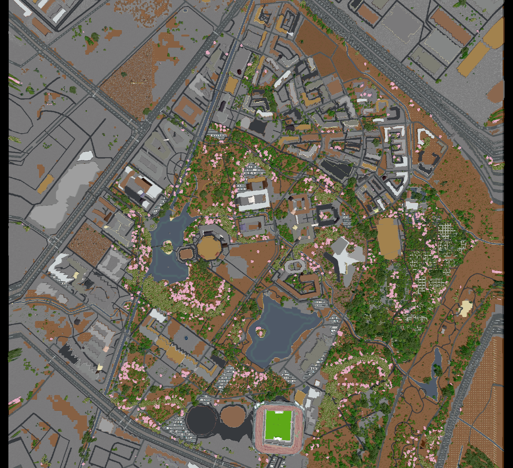

# 电子科技大学清水河校区 · Minecraft 还原

用 [arnis](https://github.com/louis-e/arnis) 从 OpenStreetMap 数据 1:1 还原的电子科技大学清水河校区 Minecraft 世界，配套 [BlueMap](https://bluemap.bluecolored.de/) 网页 3D 地图（免装 Minecraft 即可在浏览器里逛校园），123 处建筑带中文名字标注。

**在线游玩（无需安装任何东西）：https://yaowenhu-pm.github.io/uestc-minecraft/**

点击左下角"小人模式"，用虚拟摇杆操控一个 MC 小人在校园里第三人称行走（摇杆前后移动、左右转向），右下角"上/下"按钮起飞降落，落地自动贴合地形与楼顶。手机也能玩。



范围约 2km × 2km（bbox `30.7440,103.9180,30.7624,103.9386`），含图书馆、品学楼、主楼、体育场（专用 stadium 模型）、东湖西湖、各宿舍苑区。树木按 Meta/WRI 全球树冠高度数据放置，建筑来自 OSM + Overture Maps。

## 仓库内容

| 目录 | 说明 |
|---|---|
| `world/UESTC-QingShuiHe/` | Minecraft Java 版存档（1.17+，平地模式，中型树） |
| `bluemap/` | BlueMap CLI 配置（含 123 处地名标注的 marker-sets） |
| `scripts/gen_markers.py` | 从 OSM 数据批量生成地名标注的脚本 |
| `assets/` | 预览图 |

## 直接玩（有 Minecraft Java 版）

把 `world/UESTC-QingShuiHe` 整个文件夹拷进 Minecraft 的 `saves` 目录（macOS 为 `~/Library/Application Support/minecraft/saves/`），用 Java 版 1.17 以上打开即可，默认创造模式，背包里自带一张世界地图。

## 网页 3D 浏览（不装 Minecraft）

需要 Java 25+（`brew install openjdk`）。

```bash
mkdir bluemap-server && cd bluemap-server
curl -LO https://github.com/BlueMap-Minecraft/BlueMap/releases/download/v5.23/bluemap-5.23-cli.jar
java -jar bluemap-5.23-cli.jar          # 首次运行生成配置骨架
# 把本仓库 bluemap/ 下的配置覆盖到 config/，并把 maps/overworld.conf 里的
# world: 路径改成本机的 world/UESTC-QingShuiHe 绝对路径
java -jar bluemap-5.23-cli.jar -rwu     # 渲染 + 起网页服务
```

渲染完成后打开 http://localhost:8100 即可。左键拖动平移、右键拖动转 3D 视角、菜单里 Free-Flight 第一人称飞行。

## 复现要点（踩坑记录）

1. **地图全黑**：arnis 生成的世界没被游戏加载过，无光照数据，BlueMap 会把一切渲成黑色。解法：map 配置里 `ambient-light: 1.0` + `remove-caves-below-y: -10000`，然后 `-r -f` 强制重渲。本仓库配置已含此修复。
2. **假山脉**：成都平原缺高精度高程瓦片，粗瓦片插值噪声会被渲成起伏地形。本存档用 `--mode geo-only`（平地）生成，更接近真实地貌。
3. **重渲后浏览器仍显示旧图**：瓦片被浏览器缓存，硬刷新（Cmd+Shift+R）即可。
4. **树太大**：arnis 默认允许巨型树，`--max-tree-size medium` 压到行道树比例。

## 从零重新生成世界

```bash
git clone https://github.com/louis-e/arnis && cd arnis
cargo build --release --no-default-features
./target/release/arnis \
  --output-dir="./out" \
  --bbox="30.7440,103.9180,30.7624,103.9386" \
  --mode geo-only --max-tree-size medium
```

其他校区的 bbox（同一命令换范围即可）：沙河校区 `30.675036,104.0927044,30.6813191,104.1015532`。

## 数据来源与许可

- 地理数据：OpenStreetMap 贡献者，[ODbL 许可](https://www.openstreetmap.org/copyright)
- 建筑补充：Overture Maps Foundation
- 树冠高度：Meta/WRI 全球 1 米树冠数据
- 世界生成：arnis（GPL-3.0）；网页渲染：BlueMap（MIT）
